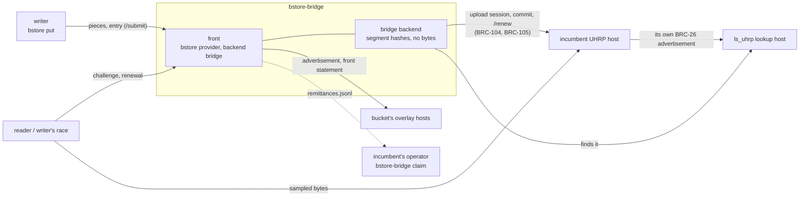

# Architecture

`bstore-bridge` joins an incumbent UHRP host to the
[bstore](https://github.com/lightwebinc/bstore) storage market without
changing it. This page is how it does that and what it trusts;
[bridge.md](bridge.md) is the operator's guide and
[configuration.md](configuration.md) every setting.

## The code

| Path | What |
| --- | --- |
| `cmd/bstore-bridge` | the command: `init`, `address`, `fund`, `rescan`, `run`, `payouts`, `claim`, `doctor` |
| `bridge` | the configuration, the bridge backend behind bstore's provider front, its state, the settlement forwarding and `claim`, `doctor` |
| `uhrp` | the incumbent client: BRC-104 sessions, BRC-105 payments, upload sessions, commits, `/renew`, the object route, `ls_uhrp` lookups, the commit build check |
| `internal/fakeuhrp` | the stand-in incumbent the tests run against |
| `third_party/goproxy` | bstore's tagged module archive, served as a file proxy until bstore's repository is public |

The front is bstore's `provider` package; everything a native provider
checks (carriers, funding, closures, the proof root, the hold policy, the
bounty) the bridge checks the same way.

## How it works

The bridge is bstore's provider (`bstore/provider`) run as a **front**
(provider backend `bridge`) over the bridge backend in this repository.

**Receiving.** Pieces and entries arrive on the front's `/submit` route,
from the plane's listener or from a writer that submits directly, and are
held to every rule a native provider holds them to: carriers, funding,
writers, quotas. Once an entry names a closure that is complete, the front
checks it (spec section 5, rows C1 to C4), recomputes the proof root, and
decides by its hold policy and the bounty's own checks, exactly as a
native provider does.

**Handing the closure over.** For a closure it takes, the front hands
every object to the backend (`Put`), which holds it to its hash and
records it as owed, keeping no bytes. The backend's `Advertise` then:

1. takes the incumbent's live advertisement of the root as it is, when one
   already lasts long enough (no upload, no payment);
2. otherwise, for a root the bridge committed before, renews it through
   the incumbent's `/renew`;
3. otherwise opens an upload session with the retention asked for, stages
   every object (read from the front's own copy, or, if the front no longer
   has it, streamed from the incumbent's own URL and held to its hash),
   and commits the root, paying the incumbent's 402 within the configured
   cap and the daily budget. A commit whose `hostedFileLocation` is not the
   incumbent's own CHIRP URL of the root is refused.

The advertisement is then found on `ls_uhrp`: by the incumbent's identity
key, the root, exactly the incumbent's CHIRP URL of the root and the root
node's length, unexpired, mined with a proof that verifies in the bridge's
own headers, and unspent by the chain view's positive evidence (a node's,
or WhatsOnChain's word). A lookup that
fails is not taken as "no advertisement": nothing is paid on it, and the
attempt is made again later. Before a commit or a renewal is sent it is
recorded as pending; one that may have been paid (the incumbent answered
an error after the payment left, or the bridge stopped) is never paid
again while its advertisement is awaited, for a day. Before the first
advertisement of a root is returned, the bridge reads every object of the
closure from the incumbent's URL and holds it to its hash.

The front checks the advertisement once more (the advertiser's key, the
root, the backend's URL, the expiry, the root node's length, the proof),
records it, and publishes it unchanged to the records topic of every
bucket it is held for, at every configured host. Then the front drops its
own copy of the bytes. It keeps, per root, the leaf hash of every 4 KiB
segment, each blob's subtree root and the closure's object list: 32 bytes
per 4 KiB segment, 1/128 of the data, about 7.8 GB per TB.

**The front statement.** The bridge publishes a front statement (spec
section 8.2) on each bucket's records topic: its own key answers
challenges and renewals for the incumbent at the bridge's front URL. A
writer's race asks the incumbent's derived front first; an unchanged
incumbent has none, so the race moves to the fronts that state they answer
for it. A host keeps a stranger's statement a day unless it is among the
first for the advertiser (spec section 12.3), so the bridge looks for its
statement at each host every `statement_check_seconds` and publishes it
again where it is missing.

**Challenges.** The front answers `/challenge` for requests naming the
incumbent as `provider` and the bridge as `answerer`, with every sample by
reference (`segment` null, spec section 7.5): the buyer fetches each
sampled segment from the incumbent's advertised URL itself. Before it
signs, the front reads every sampled segment from the incumbent's URL
through the backend and holds it to the leaf hash it keeps. A segment the
incumbent no longer serves (404 or 410, or bytes that are not the blob's)
under every root the bridge handed that names it marks the root damaged:
the answer is `422 unknown-root`, nothing is signed, and the root is not
answered for or renewed. A passing failure (a timeout, a reset, a 5xx) is a
`503` and marks nothing. Every ten minutes the front looks again at a
damaged root whose advertisement has not expired: when the incumbent serves
every object of the closure again, and a spread of up to eight blobs read
whole hold to their hashes, the root is answered for again. The front never
restores bytes; it restores its willingness to vouch, for what it has just
read. A front answers only while the advertisement it adopted is
unexpired.

Every read goes to the incumbent's object route. Nothing is answered from a
copy: the bridge holds none, and a whole blob read once is reused for no
more than five seconds, for the other samples of the same challenge.

**Range.** After each commit, and daily, the bridge checks what the
incumbent does with an HTTP `Range`: it asks for the last 4 KiB of the
closure's largest object and compares it with the same bytes of the whole
object, held to its hash.

- **Honoured:** a sample costs one 4 KiB read, for the bridge and for every
  buyer.
- **Ignored** (the incumbent answers 200 with the whole object): a sample
  costs its whole blob, up to 4 MiB, for the bridge and for every buyer;
  a challenge of `c` samples costs up to `c` x 4 MiB of reads. The bridge
  logs it and reads whole blobs from then on. An operator in front of such
  an incumbent should price challenges to cover it
  (`terms.challenge_per_sample`).
- **Wrong** (a 206 whose bytes are not the object's): the bridge reads
  whole blobs, held to their hash, from then on. The front also rechecks
  any sample whose ranged bytes do not match from the whole blob before it
  decides anything, as a buyer does (spec section 7.4), and tells the
  backend. A buyer meeting the same wrong ranges rechecks from the whole
  blob and blames nobody.

A 206 is taken only when its `Content-Range` names exactly the range asked
for and it carries exactly that many bytes.

**What a pass proves.** A by-reference sample proves that the incumbent's
public URL served the sampled bytes when the buyer asked, whoever
answered. The bridge's signature binds only the paths, which it builds
from the hashes it keeps; it cannot make a buyer believe bytes are there
that the URL does not serve, because the buyer reads them itself, and a
sample the URL does not serve is unretrievable, which is about the
incumbent's URL (spec section 7.4).

**Renewals.** `<front>/renew` is priced by the bridge's own terms and paid
to the bridge. Once paid, the front asks the backend for the later expiry;
the backend renews through the incumbent's `/renew` (as the identity that
uploaded the root, since the incumbent's renewal is owner-only), paying
the incumbent's price within the cap, waits for the incumbent's new
advertisement (which spends the old one, so it is its successor), and the
front answers the buyer with it and publishes it. The difference between
the two prices is the bridge's margin; set `terms.renew_per_gib_day` and
`terms.renew_minimum` above what the incumbent charges. A renewal that
cannot be made at once is owed and made later, as on a native provider.
For a root the bridge did not commit (one the incumbent advertised for
its own customer), a renewal is a fresh commit by the bridge.

**Settlement.** A bounty pays the advertisement's identity key (spec
section 9.5): the incumbent's. The bridge never holds that key and takes
no bounty. A writer sends its remittance to the advertiser's own derived
route (row C24), which an unchanged incumbent does not serve, so the front
finds each settlement from public data instead: for every entry it took,
it watches the hold output and, once a spend of it is mined, appends the
spend to `remittances.jsonl` in the data directory: the transaction as
Atomic BEEF with its proof, the BRC-29 derivation prefix, the sender (the
writer) and the suffix of every rank. The bridge cannot tell which rank is
the incumbent's; only the incumbent's key can.

`bstore-bridge claim -remittances FILE -key-file F` is the incumbent's
operator's tool, run where the incumbent's key already is, on a copy of the
bridge's `remittances.jsonl` (the file goes to the key, never the key to
the bridge). It reads the key from `F` (refused unless only its owner may
read it), and prints, once for each forwarded output that pays it, the
arguments of a BRC-100 wallet's `internalizeAction` (`wallet payment`: the
transaction, the output index, the prefix, the suffix and the sender). The
key is never written anywhere.

What the bridge earns: challenge fees (paid to its own key) and the margin
on renewals. What it spends: the incumbent's commit and renewal prices,
its own fees for front statements, and the delivered bytes of every piece
on the buckets it subscribes to.

## Security

- **Where the keys live.** The bridge's own key (its identity, the key it
  authenticates to the incumbent with, signs challenge responses and front
  statements under, and pays from) is in `<data>/wallet`, mode 0700. The
  incumbent's private key never reaches the bridge: its configuration holds
  only the incumbent's public identity key. A stolen bridge key can spend
  the bridge's pool, sign answers as the bridge (whose failures are the
  bridge's own, spec section 7.4) and renew roots the bridge committed;
  it cannot touch the incumbent's bounties or advertisements.
- **Answers the incumbent did not sign.** Every authenticated answer must
  carry the incumbent's configured identity key. go-sdk's BRC-104 client
  falls back to a plain HTTP request, which follows redirects and ignores
  the bridge's bounds, when a server does not complete the handshake; the
  bridge refuses such an answer and makes no further call to the incumbent
  until it is restarted, and it makes no paid call before an unpaid one has
  seen the incumbent's key. A BRC-105 payment is made only to a server that
  authenticated. The one plain request the fallback may send is the
  residue: it carries nothing secret and its answer is discarded.
- **What the bridge fetches.** Only URLs built from its configuration and
  a hash: the incumbent's base URL with a root and an object identifier,
  or with the fixed path `/chirp/v1/openapi.json` (the commit build
  check), the configured lookup hosts, and the configured overlay hosts.
  Nothing a request, an advertisement, a lookup answer or a front
  statement names is fetched. Redirects are not
  followed; every answer is bounded (4 MiB and a margin for an object,
  64 KiB for a JSON answer, 4 MiB for a lookup answer, 1 MiB for the API
  description); requests time out. The incumbent may be on a private address,
  since it is the operator's own configuration.
- **What the bridge mirrors.** Only an advertisement by the configured
  incumbent key, for a root whose closure the front checked and took for
  an entry, at exactly the incumbent's CHIRP URL of the root, unexpired,
  mined in the bridge's headers and unspent. A forged lookup answer can at
  worst hide an advertisement; it cannot make the bridge publish another
  host's, or one at another URL.
- **What the bridge pays.** At most the cap per commit or renewal
  (`max_sats_per_gib_day`, `min_payment`, which may not exceed what the
  front charges for the same time), and at most `max_sats_per_day` in any
  24 hours; a 402 over the cap is refused. A payment once sent is the
  incumbent's to broadcast; it is never paid twice for the same commit or
  renewal while its advertisement is awaited.
